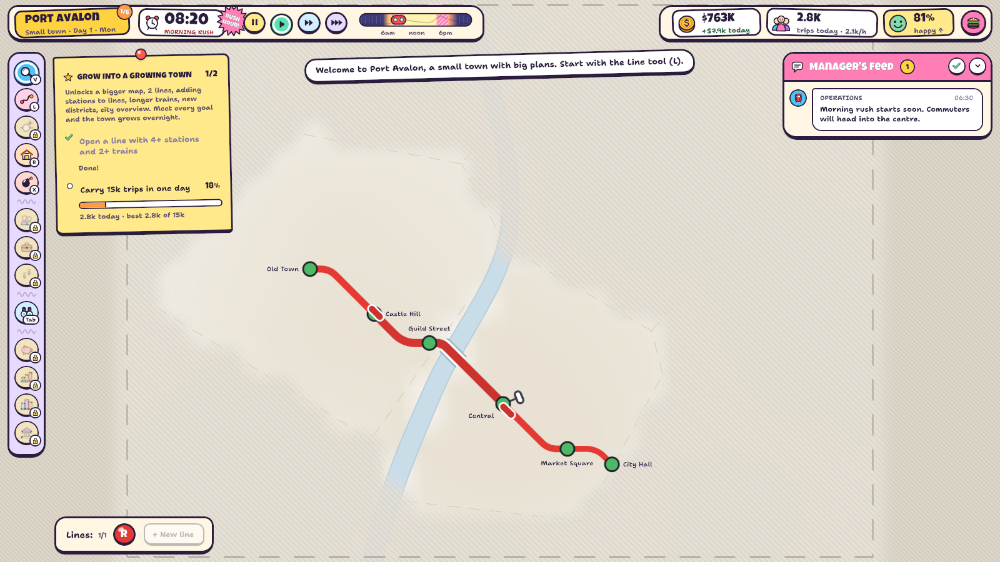
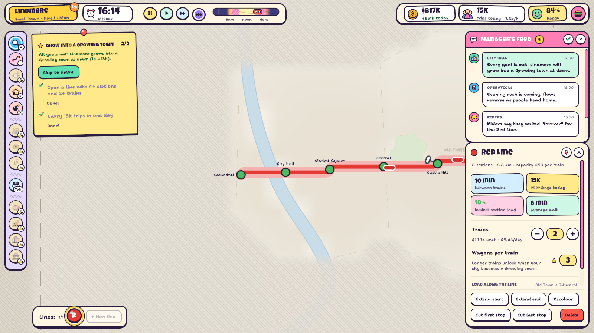
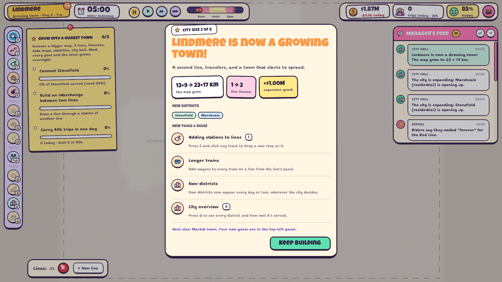
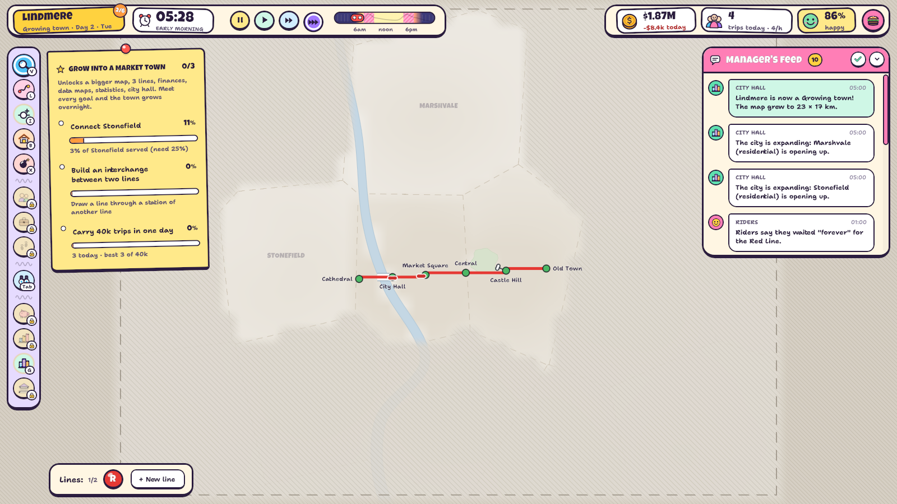
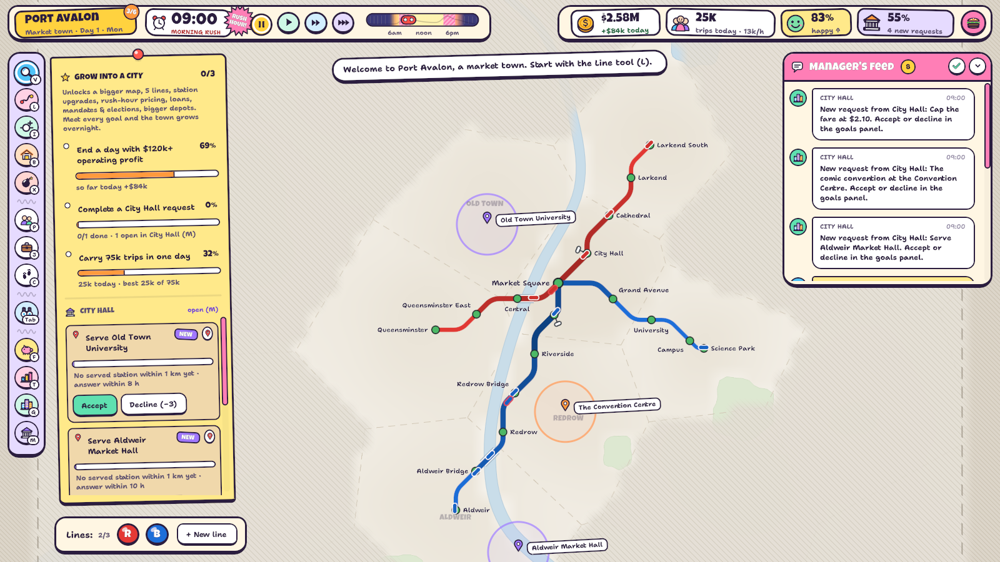
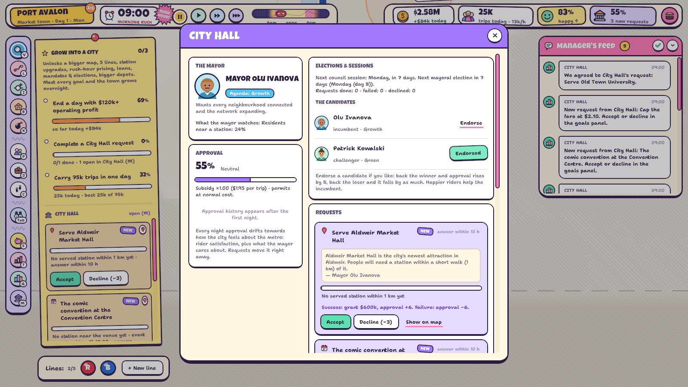
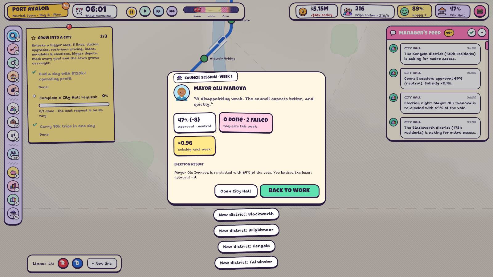
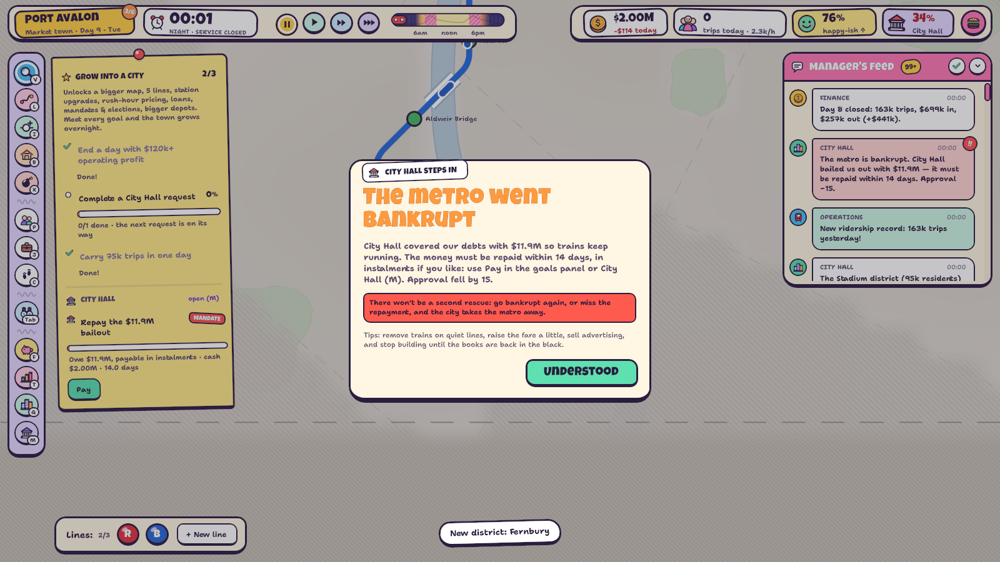

# One More Station

*(The Unity project and the exe keep the working name, MetroSimulator. The player's data lives in
`AppData/LocalLow/Metro/One More Station`.)*

A 2D, panel-driven metro management sim built in Unity 6 (6000.0.32f1, Built-in RP).
You draw lines on a schematic transit map, run trains, balance the books and keep a growing
city moving. There is no story, only interacting systems.

Every game starts as a **small town on a small map** with one line and a few tools. Meeting the
town's goals grows it overnight: the procedurally generated map opens up, new districts appear,
the line licence grows and new mechanics unlock one size at a time, up to a 48-district metropolis.
From Market town on, **City Hall** wants things from you: a mayor with an agenda sends requests,
orders and levies, and its approval decides your subsidy and, in the end, whether you keep the metro.

Version **1.0.0**, built for **Steam** (achievements, Steam Cloud saves, rich presence, overlay). It
also runs fully offline. See `Docs/STEAM.md` and `Docs/RELEASE_CHECKLIST.md`.

| | |
|---|---|
|  |  |
|  |  |

## Running it

- **In the editor:** open the project and press Play in `Assets/Scenes/SampleScene.unity`.
  Everything (camera, map, UI) is created at runtime by `GameBootstrap`, so the scene needs no setup.
- **Standalone:** `Builds/Windows/MetroSimulator.exe` (rebuild with menu *Metro → Build Windows Player (development)*).
- **Release for Steam:** *Metro → Build Release (Steam)* → `Builds/Release/1.0.0/` (see `Docs/STEAM.md`).

## Controls

| Action | Input |
|---|---|
| Pan | Right/middle-drag, left-drag on empty map, WASD / arrows |
| Zoom | Mouse wheel (zooms toward the cursor), `+` / `-` |
| Whole-city overview | `Tab` (toggle) |
| Pause / speeds | `Space`, `1` `2` `3`; once every growth goal is met, **Skip to dawn** in the goals panel fast-forwards to the growth |
| Inspect | `V`, then click a station, line, train or depot |
| Build line | `L`: click to place stations (click existing ones to connect), `F` flips the 45° bend, `Backspace` undoes, right-click / `Enter` builds, click the first station again to make a circle line |
| Plan in pencil | `K`: sketch a future line for free (`F` flips bends, `Backspace` removes a point); plans are saved with the city |
| Add station to a track | `I` |
| Depot | `B`, click a station |
| Demolish | `X` |
| Data overlays | `P` population, `J` jobs, `C` coverage |
| Finances / Stats / City / City Hall | `F`, `T`, `G`, `M` |
| Hide UI (screenshots) | `H`; `F12` saves a screenshot |
| Undo construction | `Ctrl+Z` (same day, up to 3 game hours back, refunded in full) |
| Help | `F1` |
| Back / menu | `Esc` |

Tools that haven't unlocked yet show a lock badge; their hotkeys explain when they arrive instead.
Every single-key hotkey above can be rebound in *Settings → Controls* (`Core/Keybinds.cs`). Esc,
Enter, Backspace, Ctrl+Z and the camera keys stay fixed. Hint texts show the current key, named as
printed on the player's keyboard layout.

## Learning curve: from small town to metropolis

| | |
|---|---|
|  |  |
|  |  |

`Sim/Progression.cs` holds the whole curve in one table. Each size sets the map frame (grown to
fit the next districts in the city's reveal order, never shrinking), how many districts are open,
the line licence, a one-off grant, what unlocks, and the goals that lead to the next size.

| Size | Map (typ.) | Lines | Unlocks | Goals to grow |
|---|---|---|---|---|
| Small town | ~13×10 km, 2 districts | 1 | lines, depots, demolish | a line with 4+ stations and 2+ trains; 15k trips in a day |
| Growing town | ~23×17 km, 4 | 2 | insert stations, longer trains, new districts appear, city overview | connect the new district (25%); an interchange; 40k trips |
| Market town | ~31×23 km, 7 | 3 | finances (fares, ads), data maps, statistics, **City Hall** | $120k operating profit in a day; complete a City Hall request; 75k trips |
| City | ~41×30 km, 11 | 5 | station upgrades, rush-hour pricing, loans, mandates & elections, bigger depots | an upgrade; 350k residents near a station; 140k trips |
| Big city | ~52×39 km, 17 | 8 | (more room and districts) | 6 lines running; 60% City Hall approval; 260k trips |
| Metropolis | whole region, 24+ | ∞ | everything | sandbox: City Hall keeps asking |

- **Growth happens at dawn (05:00)** once every goal is met, so each size lasts at least a day and
  the map never changes in the middle of a rush. A growth card explains the new districts, the
  bigger licence and every new tool; the frame animates outward and the camera follows.
- **New games open with an 8-step guided start** (map, first line, depot, trains, clock, first rush,
  the goals panel). Later mechanics are introduced by the growth cards instead of one long tutorial.
- Targets are tuned with the progression bot (see below). A simple bot reaches each size's goals in
  about a day early on and needs several days for the later sizes.

## City Hall: the government wants things from you

| | |
|---|---|
|  |  |
|  |  |

`Sim/Government.cs` (UI in `UI/CityHallWindow.cs`), unlocked at Market town size:

- **A mayor with an agenda.** The four agendas are Growth, Thrift, Green and People first. The agenda
  decides which requests come more often and what City Hall watches (coverage, profit, trips per
  resident, or fares and comfort).
- **Requests arrive about once a day**, as a letter in the goals panel. Accept them or decline (a
  small approval cost, higher if it's the mayor's pet topic).
  - Kinds of request:
    - connect a district
    - serve a new **landmark** (hospital, university, museum, market hall…)
    - carry N trips in a day
    - end a day above X% satisfaction
    - put N residents near a station
    - cap the fare
    - drop the rush-hour surcharge
    - add elevators
    - build interchanges
    - end the crush at a station
    - make a daily profit
    - **special events**: a match, a concert or a fair, with thousands of extra fans who need the
      metro there and back. The crowd really spawns, and the venue station has to cope.
  - Landmarks appear on the map with a walking-distance ring.
- **Approval** (0–100) moves right away with requests. Every night it also drifts towards the city's
  mood (rider satisfaction plus the mayor's agenda, minus fines and debt). It sets the **subsidy per
  rider** (×0.70–×1.25) and **permit costs** (−10% to +20% construction).
- **From City size:** **mandates** you can't refuse (with fines), **infrastructure levies** (payable
  in instalments) and **elections every two weeks**. A challenger with another agenda is announced a
  week ahead; endorse a candidate for ±8 approval. Happier riders help the incumbent.
- **Council sessions** every Monday at 06:00 review the week. Approval below 25% brings a **final
  warning**; still below at the next session, and the licence is revoked (**game over**).
- **Bankruptcy:** after three days in the red, or deep debt, City Hall bails the metro out once.
  The bailout must be repaid within 14 days, in instalments. A second bankruptcy, or missing the
  repayment, also ends the game. **Relaxed** difficulty only warns.

## Challenges

`Sim/Challenges.cs`, opened from the main menu. These are hand-made situations with one goal, a
deadline and up to three stars. A banner under the top bar shows the goal, progress and time left.
The best result per challenge is kept in the cloud-synced profile.

| # | Challenge | Start | Goal | Time | Stars |
|---|---|---|---|---|---|
| 1 | Boomtown | Small town, nothing built, $2.5M | grow into a Big city | 7 days | ★★★ within 4 days, ★★ within 5 |
| 2 | Thrift Mayor | City: 5 lines of long, half-empty trains, $1.80 fares, a Thrift mayor | $1.5M operating profit in a day | 4 days | ★★★ the first day, ★★ the second |
| 3 | Every Neighbourhood | Big city, 6 lines, a Growth mayor, $8M | 1.25M residents near a station | 5 days | ★★★ within 2.5 days, ★★ within 3.5 |
| 4 | Matchday | Market town, 2 lines, $4M, a cup final on day 2 | carry the fans there and home | until the event ends | 65% / 80% / 92% of the fans |
| 5 | Rush Hour Rescue | City, 5 lines with only 10 trains, overflowing platforms, $3M | end a day at 76% satisfaction | 4 days | ★★★ the first day, ★★ the second |
| 6 | Shoestring | Small town on Demanding, $2.1M | grow into a Market town | 6 days | ★★★ within 3 days, ★★ within 4 |

- The city only grows in the size challenges. City Hall's first letter arrives in the afternoon, and
  a challenge can block requests that would fight its goal (Thrift Mayor's council never caps fares).
- Challenges can't be saved, so they never overwrite the autosave. Finishing one shows the stars,
  the rule for each, and buttons for *Try again*, *Next challenge* and *Keep playing*.
- Two achievements: complete a challenge, and earn all 18 stars.
- **Calibration** (`RunChallengeTest`, below): doing nothing fails every challenge. The bot earns
  ★★ in Boomtown and Thrift Mayor, and ★ in the other four, so a careful player has room for three
  stars.

## What's in the game

- **Schematic map:** octilinear lines with rounded corners, parallel lanes on shared corridors,
  white bridge casings over water and interchange markers. A faint city layer sits underneath:
  coast, rivers, lakes, parks, built-up areas and dashed district borders. Hatched fog covers
  districts that don't exist yet, and a dashed frame marks the current city limits.
- **Reading the system:** station fill shows platform crowding (green → yellow → red, pulsing when
  critical). Lines get thicker and darker as they load up. Packed trains get a red rim. The top bar's
  day strip shows the demand curve and rush hours.
- **Building:** lines, extensions and circle lines; stations inserted on existing track; depots;
  trains and wagons; station upgrades (platform length → longer trains, exits & concourse →
  capacity, elevators, transfer concourse). Tunnels and bridges are priced by length, and bridges cost more.
- **Economy:** fares (+ peak surcharge), city subsidy per rider, advertising, grants. Costs are
  salaries, maintenance, construction, fines (overcrowding, idle lines, missed targets) and loan
  interest. Each lever has a downside through rider satisfaction and mode choice.
- **Growth:** besides the size steps, from Growing town on districts emerge from the fog inside the
  city limits on their own schedule and fill up over a few days. The whole city slowly densifies,
  faster near good service. Car traffic gets slower as the city grows, which pushes people onto the
  metro and congests the old central core.
- **Manager's feed:** readable messages from Operations, Riders (who sometimes exaggerate), City Hall,
  Finance and Safety. Click a message to jump to the problem.
- **Main menu** over a live demo city, the **guided start**, **challenges** (below), **save/load**
  (4 slots incl. a daily autosave and a save on quit; crash-safe writes with a `.bak`; deletable
  slots), **achievements** (32), a **help** screen (`F1`), **settings** and **credits** with
  third-party licences.
  - Settings: game (incl. colour-blind friendly crowding colours), audio, display (incl. a frame
    rate limit) and rebindable controls.
- **Undo:** `Ctrl+Z` takes back the last construction (lines, extensions, stations, depots, trains,
  wagons, upgrades, demolitions) with a full refund, up to 25 steps within 3 game hours on the same
  day (`Network/UndoHistory.cs`, recorded by `ConstructionService`).
- **Music:** a generative ambient soundtrack synthesised live (pad, bass, plucks, delay) that
  follows the time of day. No audio files. Levels were checked offline with
  `MetroHeadless.AudioCheck`: at default settings the music sits around −22 dBFS RMS (peaks about
  −10), and the effects peak between −5 and −16 dBFS with no clipping.
- **Steam:** achievements and 4 stats, Steam Cloud for saves and the profile, rich presence, and
  the overlay pauses the game. Everything falls back to offline play (`Docs/STEAM.md`).

## Code layout (`Assets/Scripts`)

| Folder | Contents |
|---|---|
| `Core/` | `GameRoot` (frame loop, selection, hotkeys, challenges, undo), `GameState` (all systems, minute/hour/day ticks), `Balance` (**every tunable number**), clock, save system, settings, `Keybinds`, input wrapper, formatting, procedural SFX and the music synth |
| `City/` | Seeded `CityGenerator` (coast, rivers, lakes, parks, Voronoi districts, cell grid), `CityModel`, `WaterSystem`, `NameBank`, `CityGrowth` |
| `Network/` | Stations, lines, track edges and depots; octilinear geometry and train kinematics; `ConstructionService` (every validated, paid change goes through here, and is recorded for undo by `UndoHistory`) |
| `Sim/` | `Progression` (city sizes, goals, unlocks), `Government` (City Hall), `Challenges`, `RoutingSystem`, `DemandModel`, `PassengerSystem`, `TrainSystem`, `Economy`, `SatisfactionModel`, `StatsTracker`, `Advisor`, `AutoPlanner` |
| `Platform/` | `PlatformServices` (Steam or offline, `SteamConfig.AppId`), `SteamPlatform` (Steamworks.NET), `Achievements`, `PlayerProfile`, `CloudSync` |
| `Render/` | Vector mesh builder + `Metro/Vector` SDF shader (pixel-clamped widths, analytic AA), map and network renderers, camera |
| `Tools/` | Inspect, line drawing, insert-station, depot and demolish tools |
| `UI/` | UI Toolkit screens built from code: HUD, feed, inspector, windows, menus, tutorial, map labels |
| `Testing/` | `AutoTest`: scripted runs of the player that save screenshots |

Editor tools in `Assets/Editor`:
- `MetroBuild`: development and release builds.
- `MetroBranding`: generates the app icon and the Steam achievement icons.
- `MetroHeadless`, `MetroFuzz`: tests.

The simulation is plain C# with no MonoBehaviours, so it runs headlessly.

### Simulation model in brief

1. **Catchments:** each populated 0.5 km cell walks to its nearest served station within 1 km.
2. **Destination choice:** a gravity model over all jobs and attractions of the developed city, so
   unserved areas leak demand and expansion pays off.
3. **Mode choice:** a logit between metro generalised cost (walk, wait = ½ headway, ride, transfer
   penalties, fare) and driving, which slows as the city grows. Satisfaction scales the share.
4. **Time of day:** weekday commute-out, commute-back and other-trip profiles (weekends differ).
   Passengers spawn per minute into per-destination waiting counts.
5. **Routing:** all-pairs Dijkstra on a station + per-line/direction platform graph. Each
   origin/destination stores its first leg (line, direction, alight station).
6. **Trains:** trapezoidal speed profile, dwell time from boarding volume, headway regulation,
   capacity-limited proportional boarding. People who don't fit are left behind, and crowded
   platforms close their gates.

## Testing & tooling

Batch-mode entry points (Unity must not have the project open):

```
Unity.exe -batchmode -nographics -quit -projectPath <project> -executeMethod <method> -logFile <log>
```

- `Metro.EditorTools.MetroHeadless.RunProgressionTest`: a bot plays a normal game from Small town
  and logs each growth, every City Hall request, session, election and bailout, and every day's
  riders, profit, satisfaction, approval and goals.
  - Options: `-seed -days -starter <stations in the first line> -difficulty`.
  - `-extra N` keeps playing N days after Metropolis.
  - `-bankrupt N` forces a bankruptcy on day N.
  - `-calib N` ignores the goals and spends exactly N days at every size, printing what a reasonable
    network achieves there. This is the tool for tuning the targets.
- `Metro.EditorTools.MetroHeadless.RunSimTest`: simulate N days with an auto-built network and print
  hourly/daily stats (`-seed -days -lines -tpk -wagons -reveal -hourly -tier`). Use it for balancing.
- `Metro.EditorTools.MetroHeadless.RunChallengeTest`: plays every challenge twice, once doing
  nothing (must fail) and once with the bot (must earn at least one star), and logs the days used.
  - `-challenge <id>` runs one challenge.
  - `-calib 1` makes the goals unreachable and logs each day's satisfaction, profit, coverage,
    trips, growth goals, City Hall letters and the ledger. Overrides: `-money -fare -tpk -wagons -lines`.
    This is the tool for tuning a challenge.
- `Metro.EditorTools.MetroFuzz.Run`: thousands of random build, demolish, train, upgrade and City
  Hall operations (`-seed -ops`). Every step checks invariants: approval range, request states,
  landmarks and the line licence. A save/load round-trip includes City Hall. The last round starts as
  a small town and is forced through every size while being built on, checking that the map never
  shrinks and no station sits outside it.
  - Undo round-trips: build, extend, delete, truncate or demolish something, undo it at once, and
    check that stations, lines, train counts, depots, track and money are exactly as before
    (about 550 per run).
- `Metro.EditorTools.MetroHeadless.AudioCheck`: renders every music mood offline (the synth is
  plain C#, `MusicSynth`) and measures peak, RMS and soft-clip load next to the sound effects at
  default settings. `-wavdir <folder>` writes 40-second previews and the effects as WAV files.
- `Metro.EditorTools.MetroBuild.BuildWindows` (development build; `-buildDir <folder>`) and
  `Metro.EditorTools.MetroBuild.BuildRelease` (`Builds/Release/<version>/`, verified for Steam).
- `Metro.EditorTools.MetroBranding.GenerateAll`: the app icon and the achievement icons.
- Player autotests: `MetroSimulator.exe -autotest <shots|play|tutorial|hall|challenge> -shotdir <dir>`
  save screenshots and a log.
  - `play` drives the real tools and UI buttons through simulated input.
  - `tutorial` plays the guided start through the first growth.
  - `hall` covers City Hall: requests, landmarks, the window, an election, a council session,
    achievements, every settings tab, a bailout, game over, credits and licences.
  - `challenge` covers the Challenges screen, the challenge banner, `F1` help, `Ctrl+Z` undo, the
    refused save, rebinding a key, the colour-blind switch, winning a challenge (stars, best result,
    achievement) and *Next challenge*.
  - `ui` (the UI session's part, `AutoTest.Ui.cs`) covers tooltips, build receipts, pencil plans,
    map bubbles, toasts and the feed.
  - `trailer` (`AutoTest.Trailer.cs`) records trailer footage. Run it at 1920×1080 windowed: each
    frame goes to `<shotdir>/frames/f_00001.jpg…` on a fixed 30 fps clock (`Time.captureFramerate`,
    which `GameRoot.FrameDt` follows), and the log marks where each scene starts and ends.
    Scenes: new town, first rush, dawn growth, City Hall, a Matchday crowd, a Metropolis close-up,
    a zoom out to the region, nightfall and the main menu.
- `Metro.EditorTools.MetroHeadless.RenderMusic`: the soundtrack rendered offline to a WAV for the
  trailer (`-out <file.wav> -seconds N -moods Morning,Rush,Day,Evening,Night`).
  - Test runs keep Steam off and use separate saves (`saves_test`) and a separate profile
    (`profile_test.json`), so they never touch the player's data.

## Known limitations / next ideas

- Shared corridors keep lane order by line id, so lines can swap sides at stations (hidden under
  the interchange marker).
- Passengers take the single best route; they won't hop on a different line that also goes their way.
- Undo only reaches back within the same day (3 game hours); money can go negative (construction
  then freezes and loans help recover).
- Challenges can't be saved; they are meant to be played in one sitting.
- Lines can't be rerouted mid-line, only extended, truncated or have stations inserted/removed.
