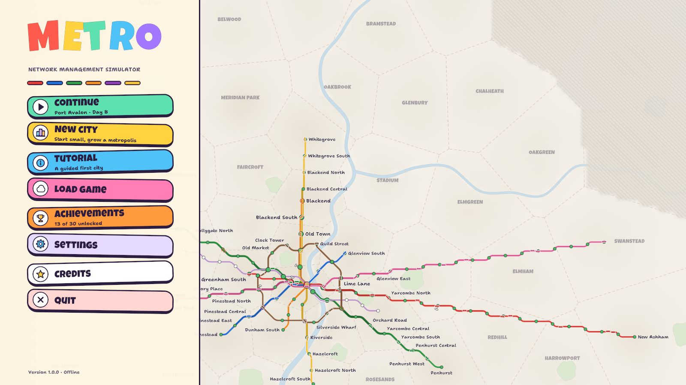
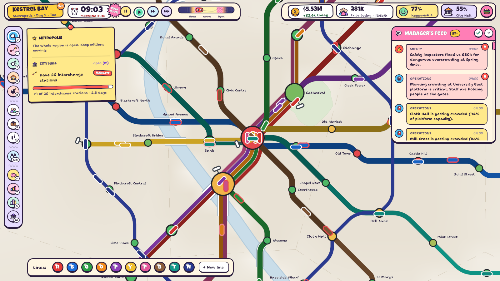
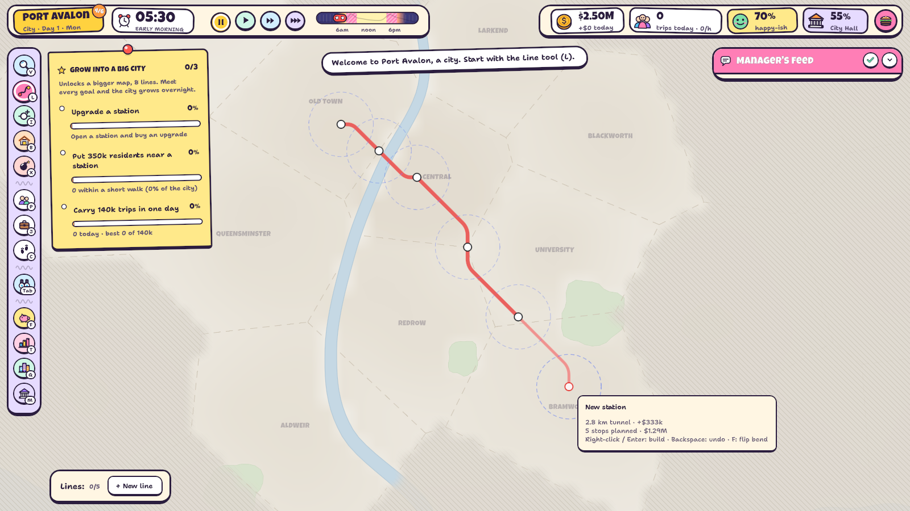
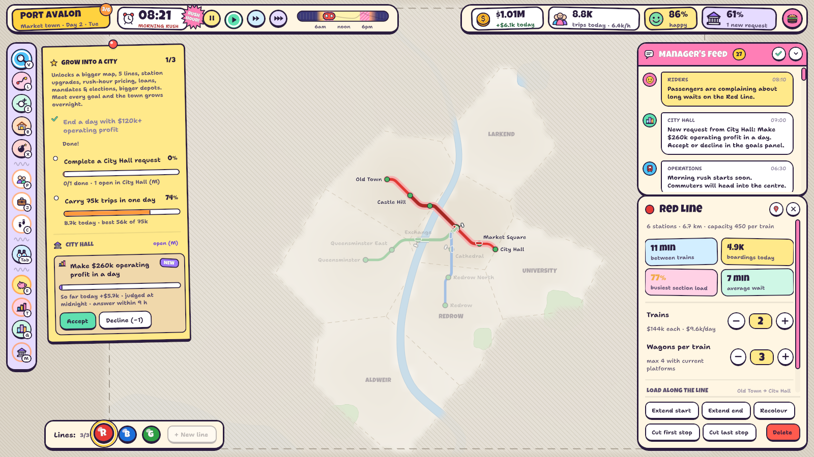

# One More Station

**A metro management sim made in Unity 6.** You draw lines on a schematic transit map, run trains, balance the books and keep a growing city moving. There is no story, only interacting systems.

Every game starts as a small town with one line. Meeting the town's goals grows it overnight: the procedurally generated map opens up, new districts appear and new mechanics unlock, up to a 48-district metropolis. From Market town on, City Hall wants things from you.

| | |
|---|---|
|  |  |
|  |  |

---

## Gameplay

- **Build a network:**
  - lines, extensions and circle lines;
  - stations inserted on existing track, depots, trains and wagons;
  - station upgrades: longer platforms, exits and concourses, elevators, transfer halls;
  - tunnels and bridges priced by length.

  You can sketch future lines in pencil for free, and `Ctrl+Z` undoes construction with a full refund.
- **Read the system at a glance:**
  - station fill shows platform crowding;
  - lines thicken as they load up;
  - packed trains get a red rim;
  - the day strip shows the demand curve and rush hours;
  - population, jobs and coverage overlays.
- **Run the money:**
  - income: fares with a peak surcharge, the city's subsidy per rider, advertising and grants;
  - costs: salaries, maintenance, construction, fines and loan interest.

  Every lever has a downside through rider satisfaction and mode choice.
- **Grow the city:**
  - Districts emerge from the fog and fill up over a few days.
  - The city densifies faster near good service.
  - Car traffic slows as the city grows, which pushes people onto the metro.
- **City Hall:** a mayor with an agenda sends requests, orders and levies. Its approval decides your subsidy, and in the end whether you keep the metro, through council sessions, elections and bailouts.
- **More:**
  - a manager's feed (Operations, Riders, City Hall, Finance, Safety) that jumps to each problem;
  - a guided start and challenges;
  - 4 save slots with a daily autosave;
  - 32 achievements, colour-blind friendly crowding colours and rebindable controls.

**Status:** version 1.0.0, built for Steam (achievements and stats, Steam Cloud saves, rich presence, the overlay), with full offline play.
- The Steam store page is filled in on Steamworks but not published yet.
- The store art and a trailer (`Steam/store/trailer/trailer.py`) are made.

## Tech stack

| Area | What it uses |
|---|---|
| Engine | **Unity 6** (6000.0.32f1), Built-in Render Pipeline, 2D |
| Simulation | **Plain C# with no MonoBehaviours**, so it runs headlessly: minute, hour and day ticks, with every tunable number in `Balance` |
| Rendering | A vector mesh builder and an **SDF shader** (`Metro/Vector`) with pixel-clamped widths and analytic anti-aliasing for octilinear lines, rounded corners and parallel lanes |
| UI | **UI Toolkit** screens built from code: HUD, feed, inspector, windows, menus, tutorial, map labels |
| Audio | A **generative ambient soundtrack synthesized live** (pad, bass, plucks, delay) that follows the time of day; no audio files |
| Platform | **Steamworks.NET**: achievements and stats, Steam Cloud, rich presence, the overlay; offline fallback |
| Saving | 4 slots, a daily autosave and a save on quit, crash-safe writes with a backup |
| Testing | Headless batch-mode bots that play whole games, every challenge and long simulations; a fuzzer; scripted runs that take screenshots |
| Store art | Python tools that generate the Steam capsules, banners and icons |

## What I built

All of it. The game code is **`Assets/Scripts/`**: 73 C# scripts, about 29k lines.

| Area | Contents |
|---|---|
| `Core/` | The frame loop, selection, hotkeys, challenges and undo; `GameState` with all systems and their ticks; `Balance`; the clock; saving |
| `City/` | Seeded `CityGenerator` (coast, rivers, lakes, parks, Voronoi districts), `CityModel`, water, names, `CityGrowth` |
| `Network/` | Stations, lines, track and depots; octilinear geometry and train kinematics. `ConstructionService` handles every validated, paid change, and records it for undo |
| `Sim/` | `Progression`, `Government` (City Hall), `Challenges`, `RoutingSystem`, `DemandModel`, `PassengerSystem`, `TrainSystem`, `Economy`, satisfaction |
| `Platform/` | Steam or offline, achievements, the player profile, cloud sync |
| `Render/`, `Tools/`, `UI/` | The vector renderer and camera, the build tools, and the UI Toolkit screens |
| `Testing/` + `Assets/Editor/` | Scripted autotests; build scripts; app and achievement icon generators; the headless test entry points and fuzzer |

### Code highlights

- **The passenger model** (`Sim/`) works in four stages:
  1. **Catchments:** each populated cell walks to its nearest served station.
  2. **Destination choice:** a gravity model over the developed city, so unserved areas leak demand and expansion pays off.
  3. **Mode choice:** a logit model between the metro's generalised cost (walk, half the headway, ride, transfers, fare) and driving.
  4. **Routing:** all-pairs Dijkstra on a station-and-platform graph.
- **`TrainSystem`:** trains follow trapezoidal speed profiles with dwell time from boarding volume, headway regulation and capacity-limited boarding. People who don't fit are left behind, and crowded platforms close their gates.
- **`City/CityGenerator`:** seeded procedural cities with coast, rivers, lakes, parks and Voronoi districts, revealed size by size as the game grows.
- **`Network/ConstructionService`:** a single gate for every change that costs money. It makes construction undoable with an exact refund.
- **`Render/`:** schematic-map rendering with an SDF shader, so lines stay crisp at any zoom.
- **Headless bots** (`MetroHeadless`):
  - one plays a normal game from Small town and logs every growth step, City Hall request, election and day;
  - another plays every challenge twice, once doing nothing (it must fail) and once properly (it must earn a star);
  - calibration modes produce the numbers that set the goals.

## Scenes

| Scene | Purpose |
|---|---|
| `Assets/Scenes/SampleScene.unity` | Everything (camera, map, UI) is created at runtime by `GameBootstrap`, so the scene needs no setup. |

## Integrated third-party assets

No Asset Store content. Everything is original except:
- the fonts **Inter** and **Shantell Sans** (SIL Open Font License) and **Luckiest Guy** (Apache License 2.0), whose license files sit next to the fonts in `Assets/Resources/Fonts/`;
- **Steamworks.NET**, a package.

## Docs

- [`PROJECT_README.md`](PROJECT_README.md): the project's own notes, covering controls, the learning curve, City Hall, challenges, the full feature list, code layout, testing and known limitations
- `Docs/STEAM.md` and `Docs/RELEASE_CHECKLIST.md`: Steam setup and the release checklist
- `Steam/store/STORE_PAGE.md`: the store page and its assets

## About this repository

This public repository is a **showcase**. It contains the documentation and the **82 source files I wrote** for this project. The complete Unity project, with the store-page material and the Steam setup, is kept in a private repository.

Copyright © Omer Avcioglu (McHunter Studio). **All rights reserved.** Viewing only; see [LICENSE](LICENSE).
